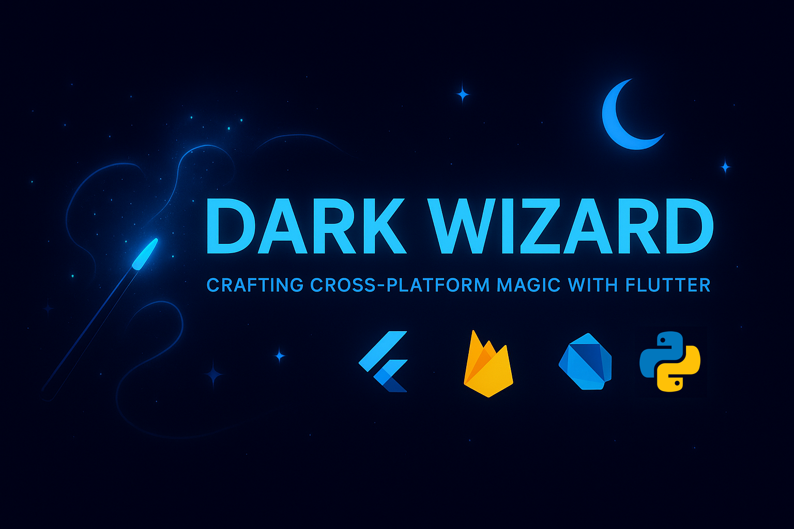

  

<h1 align="center">Hi, I'm Chaitanya Katare 👋</h1>

  <b>Flutter &amp; Full-Stack Developer</b> · Navi Mumbai, India 
  I ship production apps to Google Play and build web products with Next.js, FastAPI, Firebase and Supabase.

  
  
  

---

## 💼 What I do

- 📱 **Software Developer at Aainova**: building and running cross-platform Flutter apps, Next.js web apps, FastAPI services and the admin panels behind them.
- 🚀 **Live on Google Play**: Hommigo, Aptam and Doc Scanner, plus the Quotation System web app.
- 🎯 Open to full-time Flutter and full-stack roles.

## 🛠️ Tech stack

  
  
  
  
  
  
   
  
  
  
  
  
  
  

## ✨ Featured projects

<table>
  <tr>
    <td width="50%" valign="top">
      
      <h3><a href="https://github.com/DarkWizardCK-24/LedgerLine">LedgerLine</a> · <a href="https://ledgerline-alpha-five.vercel.app">Live</a></h3>
      Double-entry accounting for small businesses: journal, ledger, GST, reconciliation and reports. 
      Next.js · FastAPI · Supabase
    </td>
    <td width="50%" valign="top">
      
      <h3><a href="https://github.com/DarkWizardCK-24/VaultSpark">VaultSpark</a> · <a href="https://vault-spark.vercel.app">Live</a></h3>
      Zero-knowledge password manager. Everything is encrypted on your device. 
      Next.js · Firebase · Web Crypto
    </td>
  </tr>
  <tr>
    <td width="50%" valign="top">
      
      <h3><a href="https://github.com/DarkWizardCK-24/DevHub">DevHub</a> · <a href="https://dev-hub-one-opal.vercel.app">Live</a></h3>
      Developer workspace with Kanban, Markdown notes, encrypted vault and an admin audit log. 
      Next.js · FastAPI · Supabase
    </td>
    <td width="50%" valign="top">
      
      <h3><a href="https://github.com/DarkWizardCK-24/Prism-Link">Prism Link</a> · <a href="https://prism-link.vercel.app">Live</a></h3>
      Link-in-bio platform with drag-and-drop, themes, QR sharing and live analytics. 
      Next.js · Firebase · Framer Motion
    </td>
  </tr>
  <tr>
    <td width="50%" valign="top">
      
      <h3><a href="https://github.com/DarkWizardCK-24/Ledgerly">Ledgerly</a></h3>
      Multi-ledger cash book in Flutter for Android, iOS, Windows and Web. 
      Flutter · Riverpod · FastAPI · Supabase
    </td>
    <td width="50%" valign="top">
      
      <h3><a href="https://github.com/DarkWizardCK-24/Lumora">Lumora</a></h3>
      Offline-first learning tracker with streak heatmap, goals and Firebase sync. 
      Flutter · SQLite · Firebase
    </td>
  </tr>
</table>

## 🌱 Currently learning

Linux · DevOps (CI/CD, containers) · Python fundamentals

<i>Code it simple, make it powerful, and let creativity do the talking.</i>

