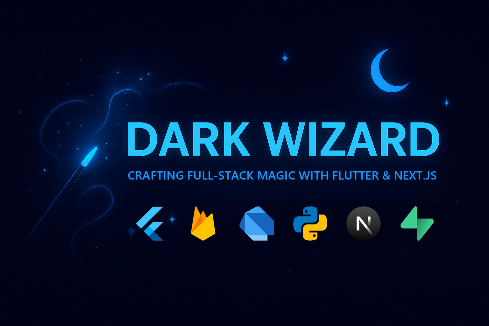

  

<h1 align="center">Hi, I'm Chaitanya Katare 👋</h1>

  

  <b>Flutter &amp; Full-Stack Developer</b> · Navi Mumbai, India 
  I ship production apps to Google Play and build web products with Next.js, FastAPI, Firebase and Supabase.

  
  
  
  

---

## 💼 What I do

- 📱 **Software Developer at Aainova**: building and running cross-platform Flutter apps, Next.js web apps, FastAPI services and the admin panels behind them.
- 🚀 **Live on Google Play**: Hommigo, Aptam and Doc Scanner, plus the Quotation System web app.
- 🎯 Open to full-time Flutter and full-stack roles.

## 🚀 Live in production

  
  
  
  

## 🛠️ Tech stack

  
  
  
  
  
  
   
  
  
  
  
  
  
  

## ✨ Featured projects

Click a card to open the live demo (web) or the repository (Flutter).

### 🌐 Full-stack web

  
  

  
  

### 📱 Flutter (cross-platform)

  
  

  <b>Source code:</b>
  <a href="https://github.com/DarkWizardCK-24/LedgerLine">LedgerLine</a> ·
  <a href="https://github.com/DarkWizardCK-24/VaultSpark">VaultSpark</a> ·
  <a href="https://github.com/DarkWizardCK-24/DevHub">DevHub</a> ·
  <a href="https://github.com/DarkWizardCK-24/Prism-Link">Prism Link</a> ·
  <a href="https://github.com/DarkWizardCK-24/Ledgerly">Ledgerly</a> ·
  <a href="https://github.com/DarkWizardCK-24/Lumora">Lumora</a>

## 📊 Languages across my repos

  

## 🌱 Currently learning

Linux · DevOps (CI/CD, containers) · Python fundamentals

<i>Code it simple, make it powerful, and let creativity do the talking.</i>

