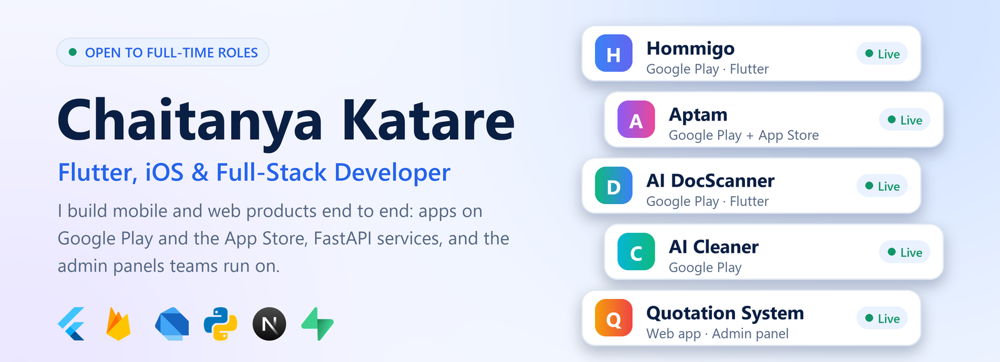
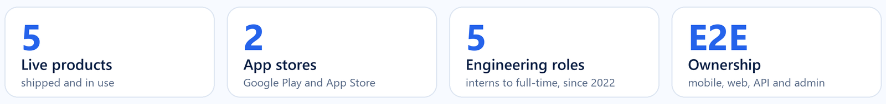
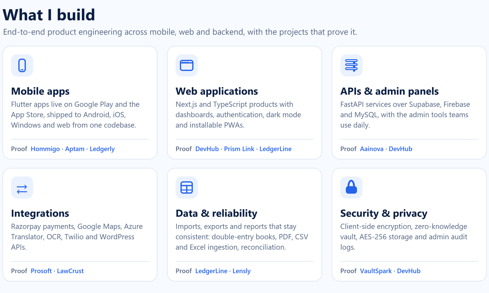
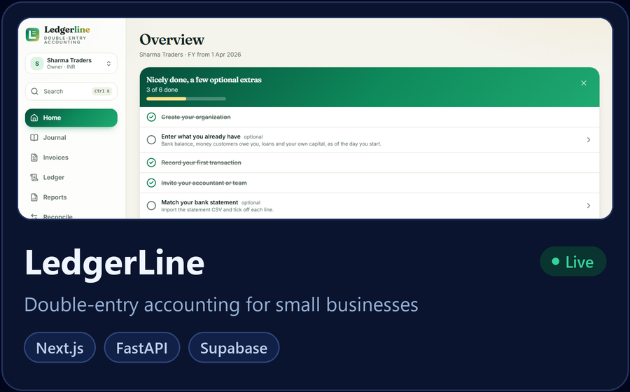
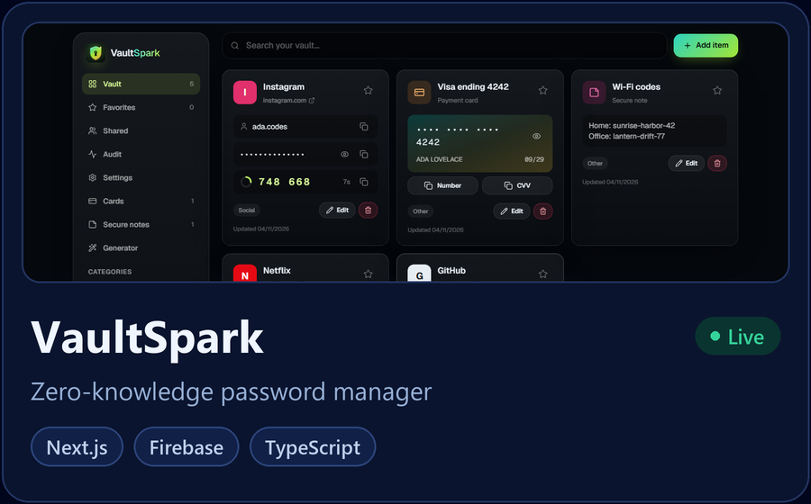
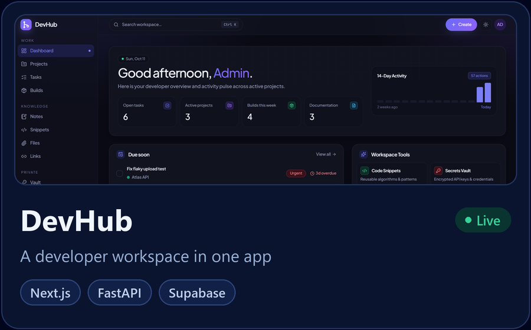
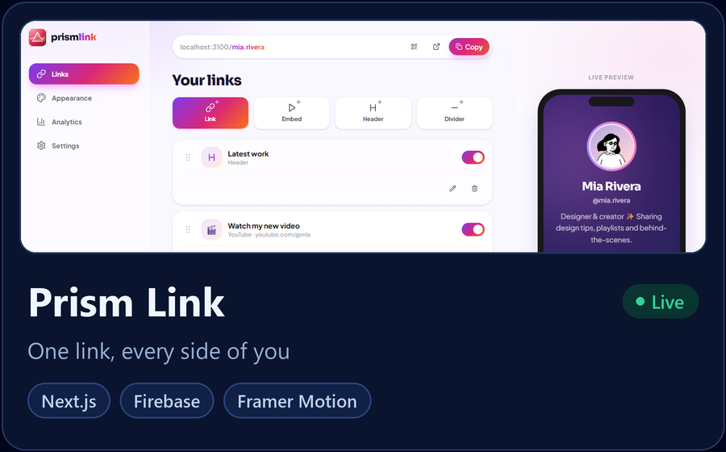
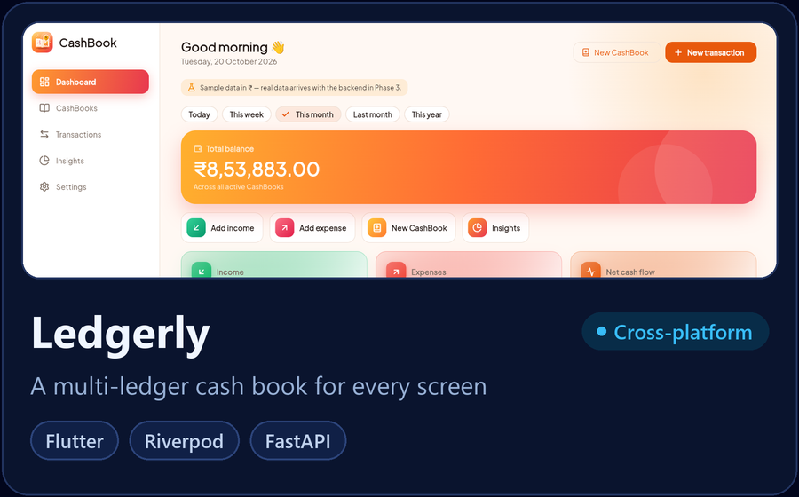
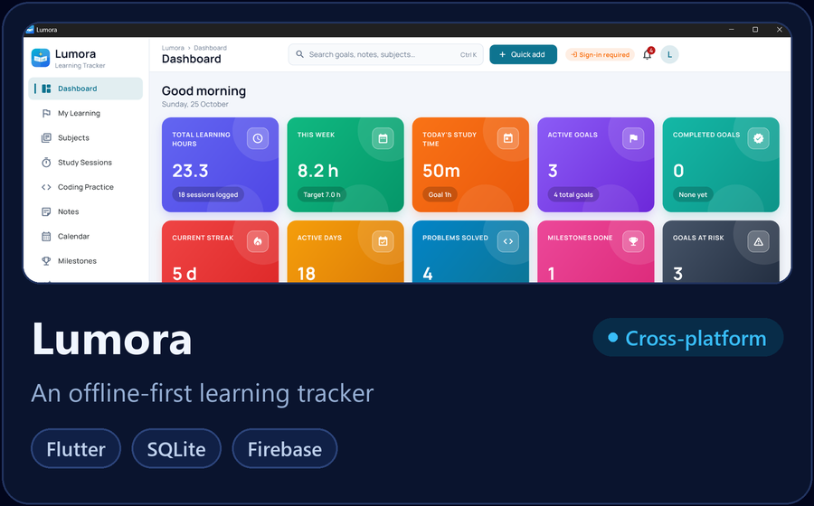

<picture>
  <source media="(prefers-color-scheme: dark)" srcset="https://raw.githubusercontent.com/DarkWizardCK-24/DarkWizardCK-24/main/assets/blocks/hero2-dark.png">
  
</picture>

  
  
  
  

<picture>
  <source media="(prefers-color-scheme: dark)" srcset="https://raw.githubusercontent.com/DarkWizardCK-24/DarkWizardCK-24/main/assets/blocks/metrics2-dark.png">
  
</picture>

<picture>
  <source media="(prefers-color-scheme: dark)" srcset="https://raw.githubusercontent.com/DarkWizardCK-24/DarkWizardCK-24/main/assets/blocks/capability2-dark.png">
  
</picture>

## Live in production

  
  
  
  
  
  

## Featured projects

Click a card to open the live demo (web) or the repository (Flutter).

### 🌐 Full-stack web

  
  

  
  

### 📱 Flutter (cross-platform)

  
  

  <b>Source code:</b>
  <a href="https://github.com/DarkWizardCK-24/LedgerLine">LedgerLine</a> ·
  <a href="https://github.com/DarkWizardCK-24/VaultSpark">VaultSpark</a> ·
  <a href="https://github.com/DarkWizardCK-24/DevHub">DevHub</a> ·
  <a href="https://github.com/DarkWizardCK-24/Prism-Link">Prism Link</a> ·
  <a href="https://github.com/DarkWizardCK-24/Ledgerly">Ledgerly</a> ·
  <a href="https://github.com/DarkWizardCK-24/Lumora">Lumora</a>

## Experience

| Company | Role | Period | What I worked on |
| :-- | :-- | :-- | :-- |
| **Aainova** | Software Developer | Jan 2026 to present | Flutter apps on Google Play and the App Store, Next.js web apps, FastAPI services and admin panels |
| **Prosoft Informatics** | Flutter Developer | May to Sep 2025 | Medical-services app for Android and iOS with Google Maps, Azure Translator and OCR |
| **LawCrust Global Consultancy** | Web & Flutter Developer Intern | Jan to May 2025 | Razorpay payments, WordPress API and Twilio booking confirmations |
| **Jio Platforms** | Frontend Developer Intern | Jan to May 2024 | RPOS front-end screens in React.js with REST APIs tested in Postman |

B.Tech in Electronics & Computer Science, Pillai College of Engineering (University of Mumbai), CGPA 8.5/10.

## Tech stack

  
  
  
  
  
  
   
  
  
  
  
  
  
  

## GitHub activity

  
  
  
  

  

## Languages

  
  

Dart and TypeScript lead, matching my Flutter and Next.js work, with Python for FastAPI backends.

## Currently learning

Linux · DevOps (CI/CD, containers) · Python fundamentals

<i>Code it simple, make it powerful, and let creativity do the talking.</i>

  

